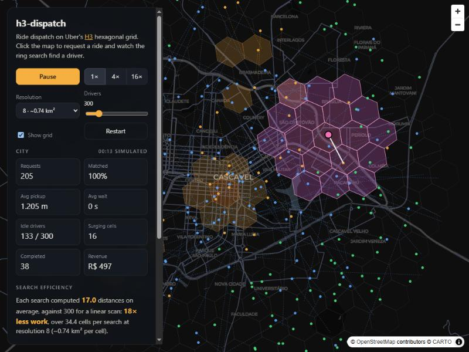

# h3-dispatch

[](https://github.com/Matheuscfs/h3-dispatch/actions/workflows/ci.yml)

A ride-hailing dispatch simulator built on [H3](https://h3geo.org), the hexagonal grid Uber open-sourced for exactly this kind of problem. Drivers cruise around Cascavel (Paraná, Brazil), riders request trips, and the dispatcher finds the closest idle driver by searching rings of hexagons outward from the pickup. Prices rise in cells where demand outruns supply.



**[Live demo → h3-dispatch.vercel.app](https://h3-dispatch.vercel.app)**. Click anywhere on the map to request a ride and watch the search expand ring by ring until it can prove it found the nearest driver.

## What's inside

| | |
|---|---|
| [`src/core/driverIndex.ts`](src/core/driverIndex.ts) | Spatial index of moving drivers bucketed by H3 cell. O(1) updates, k-nearest search by expanding rings with a provable stopping rule. |
| [`src/core/surge.ts`](src/core/surge.ts) | Surge multiplier per cell from demand and supply, smoothed over neighbouring cells. |
| [`src/core/simulation.ts`](src/core/simulation.ts) | Deterministic, seeded simulation: requests from hotspots, dispatch, pickups, drop-offs, fares and metrics. |
| [`src/app/main.ts`](src/app/main.ts) | Live map with MapLibre GL: drivers, surge cells, the traced search and controls. |
| [`scripts/bench.ts`](scripts/bench.ts) | Benchmark of ring search against a linear scan. |
| [`docs/DESIGN.md`](docs/DESIGN.md) | How this would look as a production service at city or country scale. |

The core has no DOM or map dependency, so it runs the same in the browser, in Node and in the tests.

## The interesting part: when can the search stop?

Scanning rings until you find *a* driver is not enough. The first driver found in ring 1 can be farther away than one sitting just across the boundary in ring 2, because hexagons are not circles.

The index stops only when no unscanned ring can contain anything closer than the best driver found so far. For a regular hexagonal grid with circumradius *e*, cell centers are √3·*e* apart, and the closest center in ring *r* is 1.5·*r*·*e* from the origin's center. The query point and the far point can each sit up to *e* from their own centers, so every point in ring *r* is at least

```
(1.5·r − 2) · e
```

away from the query. H3 cells vary a few percent in size between neighbours, so the bound is scaled by 0.85 to stay a true lower bound. The search stops as soon as that bound exceeds the k-th best distance found (or the maximum pickup distance).

This is checked, not assumed: the tests compare ring search against a brute-force scan on thousands of random queries, at four resolutions, for k = 1 and k = 5, including sparse cities where the nearest driver is many rings away.

## Benchmark

`npm run bench`: 2,000 queries for the nearest driver, drivers spread uniformly over a 10 km radius.

| Drivers | Res | Insert | Ring search | Linear scan | Speed-up | Cells visited | Distances computed | Same answer |
|---:|---:|---:|---:|---:|---:|---:|---:|---:|
| 1,000 | 7 | 16.06 µs | 15.2 µs | 129.1 µs | 8.5× | 7.0 | 91.9 | 100% |
| 1,000 | 8 | 3.56 µs | 5.9 µs | 129.1 µs | 21.8× | 8.4 | 17.2 | 100% |
| 1,000 | 9 | 2.73 µs | 5.4 µs | 129.1 µs | 24.1× | 19.1 | 5.7 | 100% |
| 10,000 | 7 | 3.13 µs | 254.9 µs | 815.9 µs | 3.2× | 7.0 | 923.9 | 100% |
| 10,000 | 8 | 6.54 µs | 30.6 µs | 815.9 µs | 26.7× | 7.0 | 145.0 | 100% |
| 10,000 | 9 | 2.82 µs | 9.1 µs | 815.9 µs | 90.0× | 7.5 | 23.1 | 100% |
| 100,000 | 7 | 3.55 µs | 1966.7 µs | 7728.4 µs | 3.9× | 7.0 | 9205.0 | 100% |
| 100,000 | 8 | 3.12 µs | 359.6 µs | 7728.4 µs | 21.5× | 7.0 | 1453.5 | 100% |
| 100,000 | 9 | 5.97 µs | 64.9 µs | 7728.4 µs | 119.0× | 7.0 | 215.2 | 100% |

Measured on a Windows 10 laptop with Node 24; absolute numbers vary by machine, the ratios are what matter. CI runs the benchmark on every push and writes the table to the run summary.

What the table shows:

- **Resolution is the main tuning knob.** Too coarse (res 7, ~5 km² per cell) and one cell holds hundreds of drivers, so the search degrades towards a linear scan. Finer cells cut the distances computed, until most visited cells are empty and ring lookups dominate (see 1,000 drivers at res 9: 19 cells visited to compute 6 distances). The right resolution depends on driver density, which is why a real system picks it per city.
- **Updates are cheap.** A driver only changes bucket when it crosses a cell edge; the insert cost is one `latLngToCell` call plus a map write.
- **Ring cells are cached.** The rings around a cell never change, and a city has only a few thousand cells, so computed rings are memoised (bounded to 4,096 origins).

## Surge pricing

For every cell with recent requests, and its neighbours:

1. **Pressure** = (requests in the last minute + prior) / (idle drivers + prior). The prior (2) keeps one request in an empty cell from becoming a 10× surge.
2. **Smoothing:** the cell's pressure is blended with the average of its six neighbours (35% weight). Prices change gradually across the map, and a rider cannot dodge a surge by walking one block.
3. **Rounding** down to steps of 0.1×, capped at 3×.

## Run it

```bash
npm install
npm run dev        # map at http://localhost:5173
npm test           # 44 tests
npm run bench      # benchmark table
npm run build      # static site in dist/
```

Requires Node 22 or newer.

## Simplifications

This is a model of the dispatch problem, not a clone of Uber's stack:

- **Straight-line distance.** Drivers move in straight lines and pickups are ranked by great-circle distance. A real dispatcher ranks by ETA over the road network; the ring search would still produce the candidate list, and a routing engine would re-rank it.
- **Greedy matching.** Each request takes the nearest idle driver, first come first served. Batching requests over a few seconds and solving an assignment problem gives better global results.
- **One process.** Everything runs in memory in one place. [`docs/DESIGN.md`](docs/DESIGN.md) sketches how the same ideas split across services.

## Em português

Simulador de despacho de corridas sobre o H3, a grade hexagonal que a Uber criou para esse problema. Os motoristas circulam por Cascavel, os passageiros pedem corridas e o despachante encontra o motorista livre mais próximo buscando anéis de hexágonos a partir do ponto de embarque, com uma regra de parada que garante a resposta certa. A tarifa sobe nas regiões onde há mais pedidos do que motoristas. Clique no mapa para pedir uma corrida e ver a busca acontecer.

## License

[MIT](LICENSE)
